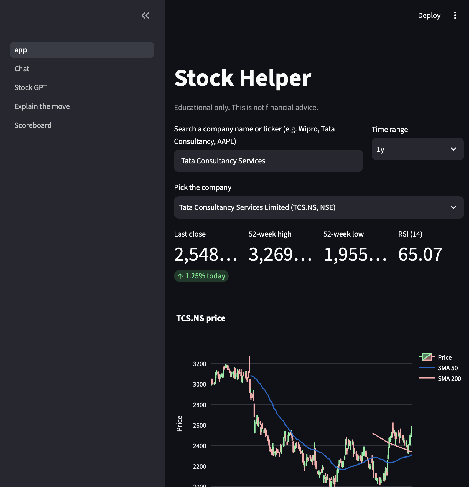
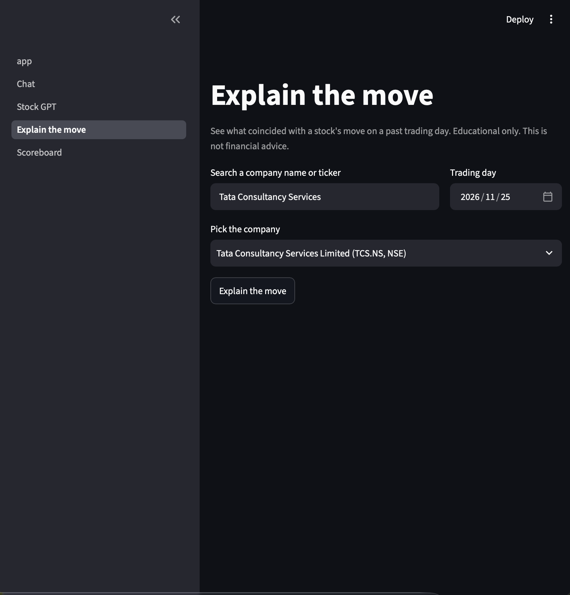
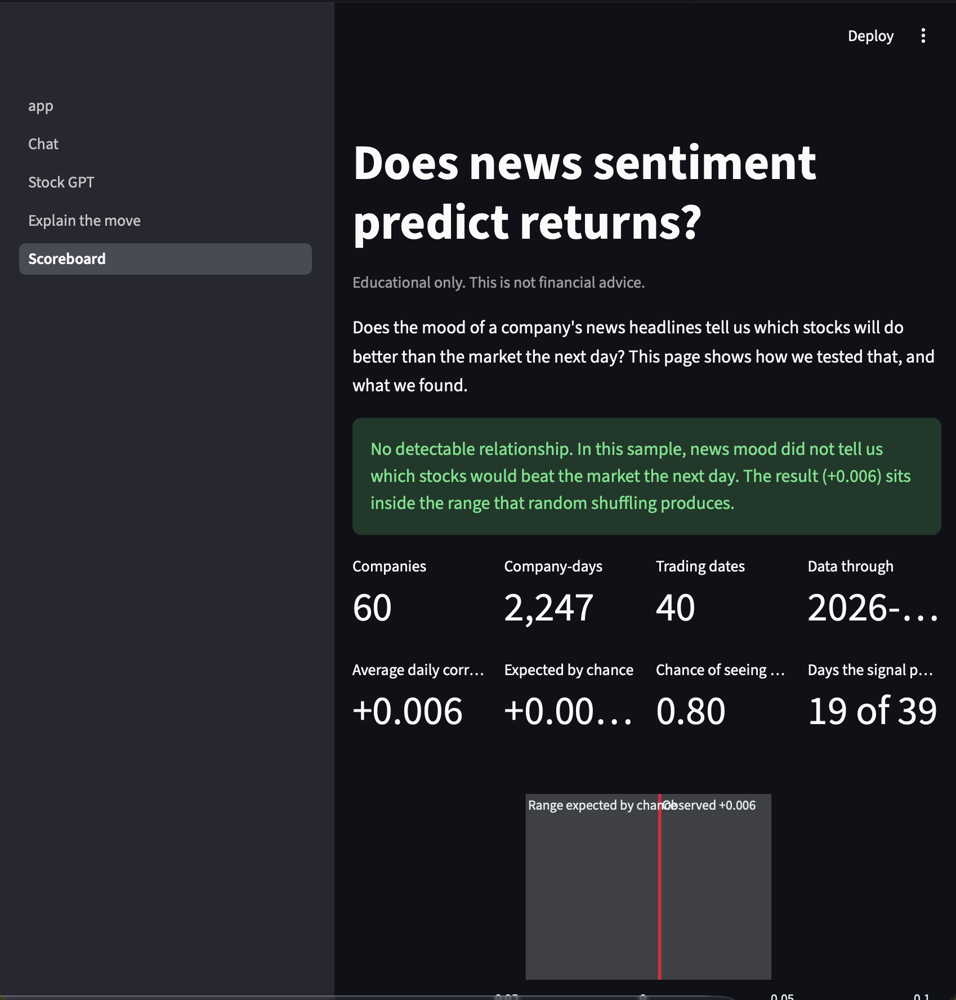

# Stock Helper

A beginner-friendly stock assistant for Indian (NSE/BSE) and global stocks. It shows charts and indicators, explains them in plain English, answers questions with real data, and explains why a stock moved on a given day.

**Live demo:** https://why-did-it-move.streamlit.app

> Educational only. This is not financial advice. The app never tells anyone to buy or sell.

## What it does

- **Stock page:** search any company by name, see a candlestick chart with 50 and 200-day averages, RSI, MACD, trend, and recent headlines, each explained in plain English.
- **Chat assistant:** ask things like "Is Infosys overbought right now?" or "What is RSI?". It calls tools for live data, shows a "Data used" line under each answer, and declines buy/sell questions. A beginner mode (on by default) defines terms from a built-in glossary and uses short answers.
- **Explain the move:** pick a stock and a past trading day. The app shows how the stock, the market index, and its sector index moved, labels the move market-wide, sector-wide, or stock-specific, and lists headlines from that window. It reports what coincided with the move, never a proven cause.
- **Scoreboard:** a test of whether news sentiment predicts next-day returns (see below).

## Screenshots

## How it works

- **Prices:** Yahoo Finance through `yfinance`.
- **News:** Google News RSS, filtered to remove price-listing pages and duplicates.
- **Sentiment:** FinBERT, a language model trained on financial text, scores headlines. It runs locally. The live app shows headlines only.
- **Assistant:** an LLM through an OpenAI-compatible API (Groq's free tier) with tool calling. Every price, indicator, and headline it mentions has to come from a tool result, and the system prompt forbids predictions and buy/sell advice. Visitors paste their own free API key in the sidebar.
- **Tests:** about 50 `pytest` tests run on every push with GitHub Actions.

## Does news sentiment predict returns?

I tested whether the mood of a company's headlines tells us which stocks beat the market the next day. Across 60 large Indian companies, 2,247 company-days, and 40 trading dates (through 13 November 2026), the average daily correlation was **+0.006**. Shuffled data averaged +0.002 with a spread of 0.022, so the result is indistinguishable from chance (p = 0.80). The signal pointed the right way on 19 of 39 days.

**The first version was wrong.** My first run showed a correlation of about 0.11, which looked too good. The effect vanished at five days, so I checked the data and found that headlines from the following day were leaking into each day's sentiment. I rebuilt the collection so each headline counts toward the first market close after it was published, and the result fell to the figures above. The method (headline timing, market-adjusted returns, the main metric) was fixed before looking at results.

**Reproduce (needs local FinBERT, takes a while):**

    pip install -r requirements-ml.txt
    python collect_v2.py 60
    python analyze_v2.py

## Limitations

- About two months of data from one period, covering only 60 large, well-covered companies.
- Stocks move together on any given day, so the company-days are not fully independent evidence.
- The sentiment model misreads some headlines, and Google News is an incomplete source.
- Only next-day and five-day horizons were tested. Not finding a relationship is not proof that none exists.
- The chat assistant is a language model, so it can word things loosely. Check the figures and the "Data used" line.
- Data comes from free sources and may be delayed or missing for some tickers.

## Run locally

    git clone https://github.com/keertanrayala-wq/stock-helper.git
    cd stock-helper
    python3.12 -m venv venv
    source venv/bin/activate
    pip install -r requirements.txt
    streamlit run app.py

For the chat, create a free key at console.groq.com and either paste it in the sidebar or put `LLM_API_KEY=your-key` in a `.env` file (see `.env.example`). For local sentiment scoring, also run `pip install -r requirements-ml.txt`. Run the tests with `python -m pytest`.

## Project layout

    app.py            stock page
    pages/            Chat, Explain the move, Scoreboard
    src/              data, indicators, news, sentiment, move analysis, assistant tools, glossary
    tests/            pytest suite
    collect_v2.py     timestamped headline collection
    analyze_v2.py     sentiment vs returns test
    results/          saved scoreboard results

## Tech

Python 3.12, Streamlit, pandas, Plotly, yfinance, feedparser, Hugging Face Transformers (FinBERT), and an OpenAI-compatible LLM client.

## License

MIT